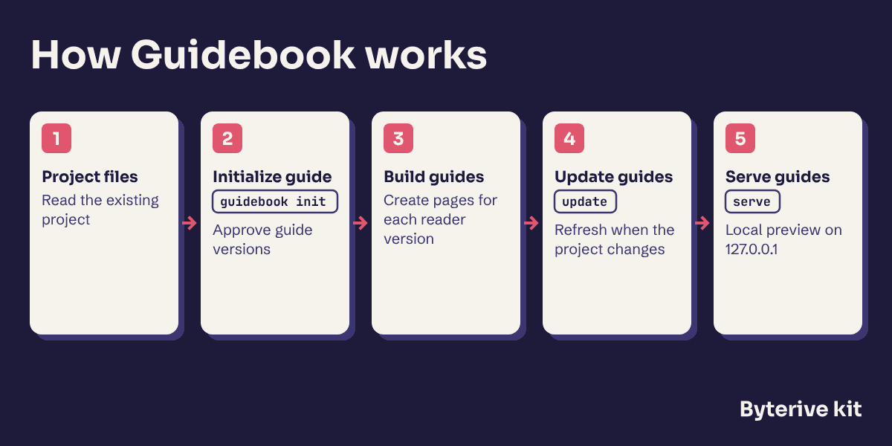
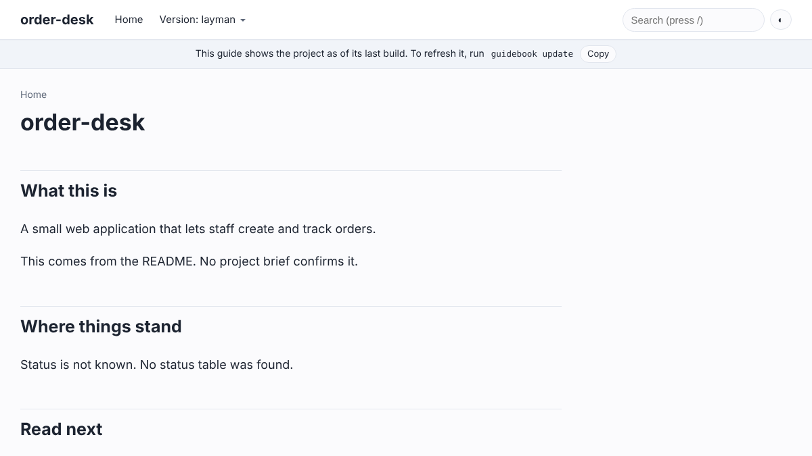

# guidebook

Plain-language guides, refreshed when your project changes.

Version 0.2.2 · early, working

## What it does

We built guidebook to turn a project into guides that people who are not the author can read. It reads the project folder, writes guides for different readers (a client, a new teammate, a maintainer), builds them as web pages, and refreshes only the pages whose sources changed when you run `update`. It never edits your existing files; it writes only `.guidebook/`, `docs/guide-src/` and `docs/guide/`.



## Install

As a Claude Code plugin, through the Byterive marketplace:

```
/plugin marketplace add Byterive/kit
/plugin install guidebook@byterive-kit
```

The tool also runs from a clone of this repository (see below).

## Try it

1. `/guidebook:guide init`
   It proposes guide versions with reasons. Add `--yes` to approve; it then writes `.guidebook/guide.json` and builds the first guide.
2. `/guidebook:guide status`
   It says whether the guide is fresh or stale, and why.
3. `/guidebook:guide update --no-model`
   It rewrites only the pages whose sources changed and keeps your own edits. With `--no-model`, nothing is sent to Claude.



*Sample project, built with `--no-model`.*

## What you get

| Command | What it does | Result |
|---|---|---|
| `init <project folder>` | Proposes guide versions with reasons; add `--yes` to approve | Writes `.guidebook/guide.json` and builds the first guide |
| `status <project folder>` | Compares the guide with the project | Says fresh or stale and why (exit code 1 if stale) |
| `update <project folder>` | Rewrites only what changed (`--no-model`, `--dry-run`, `--max-calls N`) | Fresh pages; your own edits are kept |
| `serve <project folder>` | Serves the guide on http://127.0.0.1:8765 | A "Check and update" button |

From a clone, run them as `python bin/guidebook <command> <project folder>`. In Claude Code, use `/guidebook:guide init`, `status`, `update` or `serve`. Kickoff integration: `docs/kickoff-contract.md`.

Pages land in `<project>/docs/guide-src/<version>/` and the web version in `<project>/docs/guide/`. If you edit a generated page and its sources change too, the new text goes to `<page>.proposed.md` and your page is left alone.

Lower-level steps: `python -m guidebook pages <project folder> --no-model` writes the Markdown pages only; `python -m guidebook build <project folder>` builds the HTML from existing pages. Set `PYTHONPATH=src` first.

## Needs and limits

- Python 3.10 or newer, and the `markdown` package (`pip install markdown`).
- Claude Code is optional. Without it, guidebook writes the pages without model text (`--no-model`). With it, `guidebook explain`, `init --model`, `serve --model` and the model steps of `pages` and `update` send text taken from your project (after the scrubbing described below) to Claude through `claude -p`, and the answers are cached on disk in `<project>/.guidebook/cache`. Use `--no-model` to send nothing.
- It writes only `.guidebook/` and `docs/guide-src/` (plus the built `docs/guide/`). It skips secrets, `.env*`, keys and git-ignored files, and scrubs the emails, tokens and absolute paths it recognises before anything is stored or written; check the output before you share a guide.
- Still early. Where the project does not say something, the guide says "not known".
- Privacy: see [PRIVACY.md](PRIVACY.md).

## Licence

License: MIT. Copyright (c) 2026 Junaid Iqbal (Byterive).

*Independent project by Byterive. Not affiliated with or endorsed by Anthropic.* · [byterive.com](https://byterive.com)
